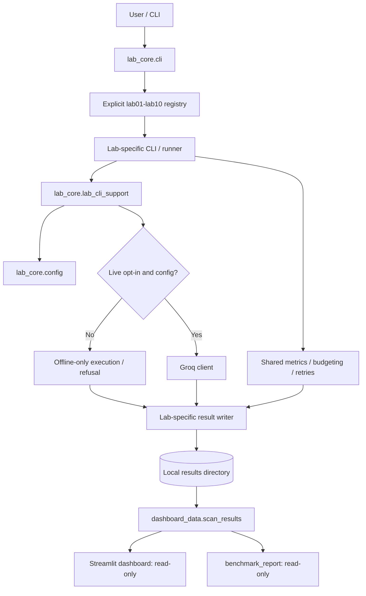

# Architecture and data boundaries

This document describes the code currently in the repository, not an aspirational
microservice architecture. The project is a local teaching/experiment application,
not a production API gateway or a multi-tenant model service.

## Component map

The chart is conceptual; not every lab invokes every shared component.
**Lab07 is simulation-only** and never creates a Groq client. The dashboard
and benchmark reporter read only approved local metric files and make no
network or provider calls.

## Ownership and responsibilities

| Component | Responsibility | Boundary |
| --- | --- | --- |
| `src/lab_core/cli.py` | Explicit registration / dispatch of 10 lab CLI subcommands | No experiment math |
| `src/lab_core/lab_cli_support.py` | Shared live-execution consent guard; runtime context and Groq client setup | Live requests require both CLI and config opt-in |
| `src/lab_core/config.py` | TOML configuration and typed settings | Default config is fail-closed |
| `src/lab_core/groq_client.py` | Sync/async provider calls and usage extraction | Provider-specific integration |
| `src/lab_core/metrics.py`, `budget.py`, `operational_retry.py` | Shared measurement, cost-estimate and resilience logic | Reused across applicable experiments |
| `src/labs/lab01_...lab10_*` | Per-lab scenario logic, CLI flags, persistence and analysis | Avoid one lab importing another lab's mutable runtime state |
| `src/lab_core/dashboard_data.py` | Allowlisted local measurement loading / conservative normalization | No provider SDK, no raw prompt export |
| `dashboard/app.py`, `dashboard_view.py` | Read-only, local visualization and presentation helpers | No experiment triggering |
| `src/lab_core/benchmark_report.py` | Pure grouping + numeric aggregation + JSON/Markdown rendering | **No provider SDK**, no writing into source result files |
| `src/lab_core/experiment_comparison.py` | Guarded selection and descriptive two-condition differences | Same run/source/scenario/cost basis; no provider calls or raw content export |
| `src/lab_core/dashboard_analytics.py` | Pure saved-run/context selection and chart-ready observed metrics | No Streamlit import or provider SDK |
| `dashboard/analytics_ui.py` | Advanced analytics interactions, validation warnings and safe downloads | Streamlit-only view; existing comparison engine owns all statistics |

## Save → normalize → report

1. A lab saves raw measurements into a run-specific folder under
   `results/<experiment>/<run_id>/`. The schema and filenames differ by lab.
2. The dashboard reader scans an explicit, limited set of filenames and
   normalizes only approved scalar metric fields. It skips invalid files with
   warnings; missing values stay `None`.
3. The benchmark tool selects **one lab and one run**. Lab07 needs an
   explicit scenario if multiple scenarios exist.
4. Metrics are separated by `experiment`, `source`, `scenario`,
   `model`, `condition`, and `cost_basis`. Each field carries an
   **observed-n** denominator; absent readings never turn into zeros.
5. Markdown or JSON output is written only when the user explicitly
   passes an output path; the default is standard output.

Only metrics are exported. Do not use benchmark reports to reconstruct or
compare raw prompt texts, model outputs or conversation details.

## Measurement semantics

- **Observed tokens:** Groq-reported usage in real experiments; not a fixed
  token estimate derived from a prompt length.
- **Estimated cost:** computed using configured pricing, not an actual bill
  or a guaranteed cost ceiling.
- **Latency:** measured in an experiment-specific manner; p50/p95 values
  should not be compared across different workloads or latency definitions.
- **Answer accuracy:** present only where an explicit saved
  `answer_correct` field exists. Missing quality observations yield `N/A`.
- **Lab07:** synthetic success/retries/429/virtual waiting. It has **zero
  real API calls**, but does not measure model correctness, real latency,
  provider token consumption or actual charges.
- **Per-request denominator:** means use only rows where the metric was
  reported. The sample size is displayed explicitly.
- **Uncertainty:** p50/p95 are nearest-rank descriptive statistics, not
  confidence bounds. No inferential superiority claim is made.

## Isolation and deployment

The `lab-runner` Compose service is a one-shot CLI and writes results.
The separate `dashboard` service listens on container port 8501 and is
published on **127.0.0.1:8502** by default. It mounts `results/`
read-only, has no Groq credentials, and runs non-root with a read-only
root filesystem. This configuration is **not** hardened for public hosting.

## Reproducibility and testing

- Dependency resolution for the Python project is committed as `uv.lock`;
  CI uses `uv sync --frozen`. The Streamlit image pins its direct
  dependency, but its transitive UI dependencies are not separately locked.
- Lab07 uses a seeded, virtual-time simulator. Recording the seed, profile,
  configuration and git commit improves reproducibility. Generated run IDs,
  manifest wall-clock timestamps and output paths vary naturally.
- Compare saved results only within matched run/scenario/workload groups.
  See [benchmark examples](../examples/README.md), the
   [benchmark methodology](benchmark-methodology.md), and the
   [data dictionary](data-dictionary.md).
- `tests/` contains deterministic offline/unit tests; live integration
  tests are excluded from normal CI by the `integration` pytest marker.
- GitHub Actions includes offline pytest, Ruff/mypy, coverage, security
  checks and an end-to-end Docker dashboard smoke test.

## Evolution guidance

The optional normalized measurement v1 contract and [Validation Engine](experiment-validation.md)
allow preflight checks of saved measurements without changing their
underlying heterogeneous raw formats. Future work should add full raw
schema registries and migration tests before changing
on-disk formats. Consider dedicated provider interfaces only when a second
provider is actually implemented. Do not claim the existence of a gateway,
queue, distributed scheduler, remote result store or fully locked dashboard
dependencies that the current project does not provide.
